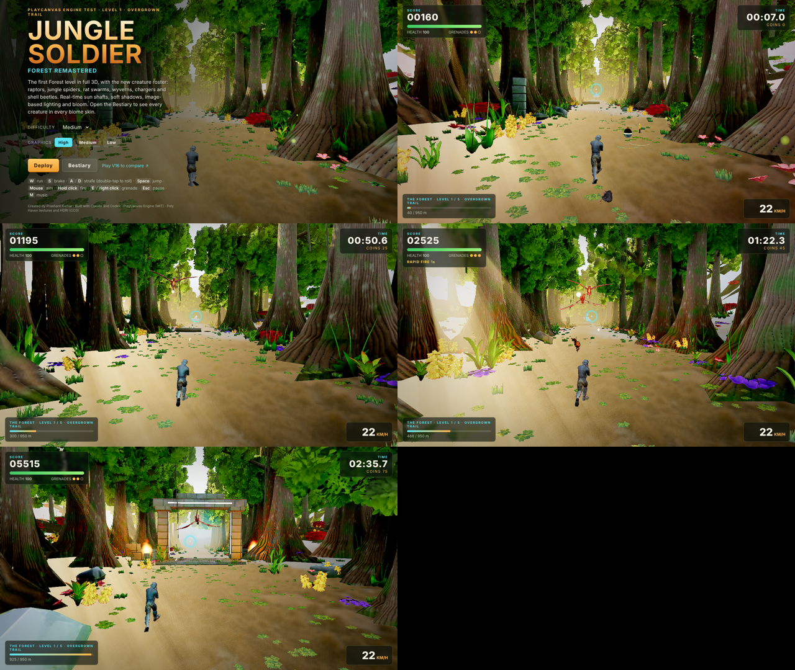

# Jungle Soldier 3D

**Play it:** https://pkumar1301.github.io/Jungle_Soldier_3D/

Jungle Soldier 3D is a third-person run-and-gun game that runs in the browser. You run a soldier down a jungle trail, shoot what comes at you and reach the temple gate at the end. It is a full 3D remake of [Jungle Soldier V16](https://pkumar1301.github.io/Arcade_Archer/), the 2.5D game in the [Arcade_Archer](https://github.com/pkumar1301/Arcade_Archer) repository. The two games share an idea and a soldier. They don't share code.

The game is built on the [PlayCanvas](https://playcanvas.com/) engine. It has real-time sun shafts, soft shadows, image-based lighting, bloom and animated creature models.



## Status

This is an early build. One level is playable: the Forest, Level 1, "Overgrown Trail". It is 950 m long and takes about 2 minutes 40 seconds at a full run. The other biomes and the bosses are planned (see [What comes next](#what-comes-next)).

The first visit downloads about 70 MB of models and textures, so expect a slow first load. Later visits come from the browser cache.

## How to play

| Key | Action |
| --- | --- |
| W | Run |
| S | Brake |
| A / D | Strafe; double-tap to roll |
| Space | Jump |
| Mouse | Aim |
| Hold left click | Fire |
| E or right click | Throw a grenade |
| Esc | Pause |
| M | Music on or off |

Pickups sit along the trail: coins for score, health packs, grenades (you carry up to three) and a rapid-fire power-up that raises your fire rate by half for 15 seconds.

There are three difficulty levels. Easy cuts the damage you take to 60% and spaces the enemy waves out; Hard raises damage by half and brings waves faster.

## Enemies

The Forest has nine kinds of enemy. Each one shows a one-line tip the first time it appears.

| Enemy | Role | How to beat it |
| --- | --- | --- |
| Raptor | Rusher | It rears up for 0.6 s before it lunges. Strafe away. |
| Jungle spider | Spitter | Keeps 12 to 15 m away. Its acid lands on a green ring, so step off the ring. |
| Jungle rats | Swarm of five | Each bite is small, but rats you run past still cost 2 health. Thin them out. |
| Bloated rat | Exploder | Shoot it early. Its burst hurts you and any enemy nearby. |
| Wyvern | Flyer | Spits fireballs, then dives onto a red ring. Roll out. |
| Charger | Elite | Roars and marks a red lane, then charges. Dodge it and it's stunned, taking double damage. |
| Shell beetle | Armoured blocker | Bullets bounce off its front. Flank it or use a grenade. |
| Trapdoor spider | Ambusher | Watch for the ground moving ahead of you. |
| Turret | Turret | Hit the glowing core on its back. |

## Bestiary

The Bestiary button on the menu shows every creature model in all five biome skins: Forest, Desert, Tundra, Volcano and Alien Hive. That includes creatures meant for later biomes, such as the imp, the giant ant, the razorback boar and the mushroom dragon.

The skins aren't separate models. The game recolours each model's own texture by tone and adds a glowing layer, like cracks of lava or frost, so one model can play a different enemy in each biome.

## Graphics settings

| Setting | What it turns on |
| --- | --- |
| High | 3 shadow cascades, light shafts, ambient occlusion, 4x anti-aliasing |
| Medium | 2 shadow cascades, light shafts |
| Low | 1 shadow cascade, lower resolution |

If the frame rate stays under 34 fps for 4 seconds, the game drops one level by itself. To force a level, add `?q=low` or `?q=medium` to the address.

## What comes next

- Five more biomes after the Forest: Desert, Tundra, Volcano, Alien City and Space. Most of their enemies are already in the Bestiary as skins.
- Bosses: a sandworm (reused as a lava serpent), an ice golem, an alien mothership and the Overmind. Their models are still being made.
- A licence check on every downloaded creature model before any public or commercial release (see [CREDITS.md](CREDITS.md)).

## How it was made

Prashant Kumar designed the game and sourced the 3D models. Claude, Anthropic's AI model, wrote the code, built the scene and tuned the balance.

The trail, tree trunks, temple gate and turrets are built in code. The leaves, ferns, flowers, bushes and rocks come from Quaternius's free Stylized Nature MegaKit. The creatures are downloaded models; the larger ones were cut down to 20,000 to 40,000 triangles with a reducer in `tools/`, and their textures were shrunk to 1024 px.

The level was balance-tested with a built-in bot that plays the whole run and reports where its damage came from. On Medium it reaches the gate with about half its health left.

## Run it locally

The game needs a web server, because browsers won't load the models from a file on disk:

```sh
git clone https://github.com/pkumar1301/Jungle_Soldier_3D.git
cd Jungle_Soldier_3D
python3 -m http.server 8775 --bind 127.0.0.1
```

Then open http://127.0.0.1:8775/.

## Files

| Path | Contents |
| --- | --- |
| `index.html` | Page, HUD, menus and Bestiary |
| `js/game.js` | Game loop, enemy behaviour, combat, HUD and test hooks (`window.pcTest`) |
| `js/creatures.js` | Creature list: model files, animation clips, facing and scale |
| `js/skins.js` | Biome skins |
| `js/world.js`, `js/scenery.js` | The Forest scene and its MegaKit foliage |
| `js/models.js`, `js/fx.js`, `js/textures.js`, `js/music.js` | Turrets, pickups, projectiles, particles, generated textures and music |
| `js/playcanvas.min.mjs` | PlayCanvas engine v2.24.3 |
| `models/` | Creature models and the MegaKit subset |
| `assets/` | Soldier, sky and ground textures |
| `tools/` | Engine build script, model reducer, texture shrinker and preview pages |

## Credits

PlayCanvas engine (MIT). Stylized Nature MegaKit by Quaternius (CC0). Forest floor textures and sky from Poly Haven (CC0). Soldier from Adobe Mixamo. The full list, including the creature models whose licences still need confirming, is in [CREDITS.md](CREDITS.md).
